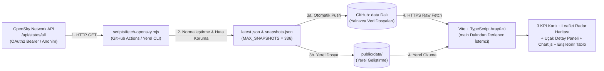

# Ege Hava Sahası Canlı

**Manisa Celal Bayar Üniversitesi — Büyük Veri Analistliği Programı**  
*(İlk Ara Kontrol Temel Sürümü — Bulut Bilişim ve Siber Güvenlik Entegrasyonuna Hazır Altyapı)*

**Ege Hava Sahası Canlı**, Ege Denizi ve çevresindeki sivil hava trafiğini (`36.5°K–40.5°K`, `24.5°D–30.5°D`) **OpenSky Network** verileri üzerinden toplayan, normalleştiren ve koyu radar estetiğinde erişilebilir (WCAG AA uyumlu) bir web arayüzünde görselleştiren bir gözlem ve analiz uygulamasıdır.

---

## İçindekiler

1. [Kurulum ve OAuth2 Kimlik Doğrulama Ayarları](#1-kurulum-ve-oauth2-kimlik-doğrulama-ayarları)
2. [Çalıştırma](#2-çalıştırma)
3. [Veri Kaynağı, Sınır Kutusu ve Saklama Süresi](#3-veri-kaynağı-sınır-kutusu-ve-saklama-süresi)
4. [Basit Mimari Şeması ve `data` Dalı Stratejisi](#4-basit-mimari-şeması-ve-data-dalı-stratejisi)
5. [Arayüz Özellikleri ve Erişilebilirlik](#5-arayüz-özellikleri-ve-erişilebilirlik)
6. [Harita ve Veri Atıfları (OpenStreetMap & OpenSky)](#6-harita-ve-veri-atıfları-openstreetmap--opensky)
7. [Lisans](#7-lisans)
8. [Yapay Zekâ Kullanım Beyanı](#8-yapay-zekâ-kullanım-beyanı)

---

## 1. Kurulum ve OAuth2 Kimlik Doğrulama Ayarları

Projeyi yerel ortamınızda kurmak için **Node.js (v20 veya v22+)** ve **npm** gereklidir.

```bash
# Depoyu klonlayın
git clone https://github.com/Fylgja0/ege-hava-sahasi-canli.git
cd ege-hava-sahasi-canli

# Bağımlılıkları yükleyin
npm ci
```

### OpenSky OAuth2 (`client_credentials`) ve GitHub Secrets Yapılandırması

> **Güvenlik Notu:** Kaynak kod, JSON veri dosyaları, günlükler (log) veya istemci (frontend) derlemesi içerisinde hiçbir API anahtarı, istemci sırrı veya erişim belirteci (token) **bulunmamaktadır**.

`scripts/fetch-opensky.mjs` iki erişim modunu destekler:
1. **Anonim Erişim (Varsayılan):** Ortam değişkenleri tanımlı değilse doğrudan anonim `GET` isteği gönderilir.
2. **OAuth2 İstemci Kimlik Bilgileri (`OPENSKY_CLIENT_ID` ve `OPENSKY_CLIENT_SECRET`):** Bu iki ortam değişkeni tanımlıysa betik önce OpenSky resmi OpenID Connect token uç noktasına (`https://auth.opensky-network.org/auth/realms/opensky-network/protocol/openid-connect/token`) `application/x-www-form-urlencoded` biçiminde `grant_type=client_credentials` ile `POST` isteği gönderir; dönen `access_token` değerini `/api/states/all` çağrısında `Authorization: Bearer <token>` başlığı olarak kullanır.

#### GitHub Actions İçin GitHub Secrets Tanımlama Adımları
GitHub Actions paylaşımlı IP adreslerinde anonim istek limitine (`HTTP 429`) takılmamak için kendi OpenSky OAuth2 istemci bilgilerinizi depoya güvenli biçimde ekleyebilirsiniz:

1. [OpenSky Network Hesap Paneli](https://opensky-network.org/) üzerinden hesabınıza giriş yapın ve **OAuth2 API Client** oluşturarak `client_id` ile `client_secret` bilgilerinizi alın.
2. GitHub deponuzun sayfasında üst menüden **Settings** sekmesine tıklayın.
3. Sol menüden **Secrets and variables** → **Actions** bölümüne gidin.
4. **New repository secret** düğmesine tıklayarak aşağıdaki iki gizli değişkeni ayrı ayrı ekleyin:
   - **Name:** `OPENSKY_CLIENT_ID` — **Secret:** *(OpenSky istemci kimliğiniz)*
   - **Name:** `OPENSKY_CLIENT_SECRET` — **Secret:** *(OpenSky istemci gizli anahtarınız)*
5. Bu değişkenler tanımlandığında `.github/workflows/fetch-opensky.yml` iş akışı otomatik olarak OAuth2 Bearer kimlik doğrulamasına geçer; tanımlanmadığında ise anonim modda çalışmaya devam eder.

---

## 2. Çalıştırma

```bash
# 1. OpenSky API'den Ege hava sahası verisini çekin ve normalleştirin
npm run data:fetch

# 2. Geliştirme sunucusunu başlatın (http://localhost:5173)
npm run dev

# 3. Tip kontrolü ve üretim (production) derlemesi alın
npm run build

# 4. Üretim derlemesini yerel olarak önizleyin
npm run preview
```

---

## 3. Veri Kaynağı, Sınır Kutusu ve Saklama Süresi

Uygulama, tarayıcıdan doğrudan dış API çağrısı **yapmaz**. Veriler `scripts/fetch-opensky.mjs` Node.js betiği aracılığıyla resmi OpenSky REST API uç noktasından çekilir:

- **Resmi Uç Nokta:** `https://opensky-network.org/api/states/all`
- **Ege Sınır Kutusu (Bounding Box):**
  - `lamin = 36.5` (Güney sınırı)
  - `lomin = 24.5` (Batı sınırı)
  - `lamax = 40.5` (Kuzey sınırı)
  - `lomax = 30.5` (Doğu sınırı)
- **Alan Hesabı ve Kota Uyumu:** $(40.5 - 36.5) \times (30.5 - 24.5) = 4^\circ \times 6^\circ = 24\text{ kare derece}$. Bu alan, OpenSky Network'ün $< 25\text{ kare derece}$ küçük alan kotasına (istek başına yalnızca 1 kredi tüketimi) tam uyumludur.
- **Snapshot Saklama Sınırı (7 Günlük Geçmiş):** Otomatik veri toplama sıklığı **30 dakika** (saatte 2 ölçüm, günde 48 ölçüm) olduğundan, 7 günlük zaman serisi geçmişini eksiksiz saklamak üzere `MAX_SNAPSHOTS = 336` ($7 \times 24 \times 2 = 336$ kayıt) olarak yapılandırılmıştır.

### Hata Yönetimi ve Veri Koruma İlkeleri
`scripts/fetch-opensky.mjs` aşağıdaki durumları açıkça yakalar ve sınıflandırır:
- `TIMEOUT`: İstek zaman aşımı (varsayılan 15 saniye).
- `HTTP_429`: İstek limiti aşımı (`Too Many Requests`).
- `EMPTY_RESPONSE`: Boş veya geçersiz `states` dizisi.
- `NETWORK_ERROR` / `HTTP_ERROR`: Bağlantı veya sunucu/kimlik doğrulama hataları.

**Veri Koruma ve Çıkış Kodu Garantisi:**
1. Herhangi bir hata durumunda daha önce kaydedilmiş son başarılı `latest.json` ve `snapshots.json` verileri **asla silinmez**, hata anında `snapshots.json` içerisine sahte canlı ölçüm eklenmez; yalnızca `lastAttempt` alanı hata detayı ile güncellenir.
2. Henüz diskte hiç gerçek veri yoksa ve canlı API çağrısı başarısız olursa, hata gizlenmez; arayüzün doğrulanabilmesi için üretilen yedek veri `isDemo: true` ve `source: "demo-fallback"` olarak işaretlenir, çağrı adlarına `[DEMO]` etiketi eklenir ve arayüzde açıkça **"DEMO VERİSİ AKTİF (Canlı Veri Değil)"** uyarısı gösterilir.
3. Veri dosyaları güvenle korunduktan sonra `npm run data:fetch` komutu **sıfır olmayan çıkış koduyla (`exit code 1`)** sonlanarak CI/CD izleme sistemlerine hatayı doğru biçimde bildirir.

---

## 4. Basit Mimari Şeması ve `data` Dalı Stratejisi

Sürüm kodunun bulunduğu korunan `main` dalının otomatik veri commit'leriyle kirlenmesini önlemek amacıyla **kod ve veri dalları birbirinden ayrılmıştır**:



### Arayüzün `data` Dalındaki Veriyi Okuma Yöntemi ve İş Akışı Davranışı
1. **Otomatik Veri Toplama (`.github/workflows/fetch-opensky.yml`):**
   - Her 30 dakikada bir (`cron: '*/30 * * * *'`) veya GitHub Actions sekmesinden **manuel (`workflow_dispatch`)** olarak tetiklenir.
   - Uygulama kodunu `main` dalından alır; uzak depoda `origin/data` dalı mevcutsa geçmiş `latest.json` ve `snapshots.json` dosyalarını geri yükler, henüz `data` dalı yoksa ilk çalışmada `data` dalını otomatik olarak oluşturur.
   - `npm run data:fetch` çalıştıktan sonra (çekim başarısız olsa bile) yayınlama adımı çalışır. Ancak tekrarlayan API kesintilerinde her 30 dakikada bir yalnızca `lastAttempt.timestamp` değiştiği için gereksiz commit üretilmesini önlemek adına, son başarılı veri (`fetchedAt`), snapshot geçmişi ve hata türü (`errorType`) değişmemişse yeni commit atılmaz.
   - Yayınlama adımı tamamlandıktan sonra, eğer `npm run data:fetch` hata döndürmüşse son adım işi (`job`) **başarısız (`failed`)** olarak işaretler.
2. **İstemci (Tarayıcı) Veri Okuma (`src/dataService.ts`):**
   - İstemci, `VITE_DATA_BASE_URL` ortam değişkeni tanımlıysa veya GitHub Pages (`*.github.io`) üzerinde çalışıyorsa doğrudan `data` dalındaki ham JSON adresinden (`https://raw.githubusercontent.com/Fylgja0/ege-hava-sahasi-canli/data/data/latest.json` ve `snapshots.json`) veriyi okur.
   - Yerel geliştirmede (`npm run dev` / `npm run preview`) veya uzak dala henüz erişilemediğinde otomatik olarak yerel `./data/latest.json` ve `./data/snapshots.json` dosyalarını okur.

---

## 5. Arayüz Özellikleri ve Erişilebilirlik

- **3 KPI Kartı:** Aktif uçak sayısı (havada/yerde), ortalama barometrik irtifa (`m` / `ft`) ve ortalama yer hızı (`km/h` / `knot` / `m/s`).
- **İnteraktif Ege Radar Haritası (Leaflet):** Sınır kutusu çerçevesi, uçuş yönüne göre dönen uçak simgeleri ve seçim vurgusu.
- **Seçili Uçak Detay Paneli:** Haritadan veya tablodan bir uçak seçildiğinde barometrik/jeodezik irtifa, yer hızı (`km/h`, `knot`, `m/s`), dikey hız (`m/s`), baş açısı, ülke ve son temas zamanını gösterir.
- **Saatlere Göre Uçuş Sayısı Grafiği (Chart.js):** `snapshots.json` üzerinden zaman serisi grafiği, ekran okuyucular için dinamik **metinsel özet** (tek ölçüm olduğunda uydurma geçmiş üretmeden yalnızca 1 ölçüm bulunduğunu açıkça belirten özet) ve **erişilebilir veri tablosu alternatifi** (`<table>`).
- **Erişilebilir Uçak Listesi/Tablosu:** Harita üzerindeki tüm uçakları arama/filtreleme desteği ve klavye ile odaklanabilir *"Detay & Odakla"* düğmeleriyle sunar.
- **Ayrı Durum Gösterimleri:** `Yükleniyor`, `Boş Sonuç`, `Hata (HTTP 429 / Zaman Aşımı / Ağ Hatası)`, `Eski Veri (>30 dk)` ve `Demo Verisi` durumları ayrı bildirim bantlarıyla gösterilir ve üst araç çubuğundan test edilebilir.
- **Duyarlı ve Erişilebilir Tasarım:** Koyu radar estetiği, tek vurgu rengi (`#2dd4bf`), WCAG AA kontrast uyumu, görünür `:focus-visible` klavye odağı, `360px` mobil ve `1440px` masaüstü ekran desteği.

---

## 6. Harita ve Veri Atıfları (OpenStreetMap & OpenSky)

- **Harita Katmanı (Zorunlu Atıf):** Harita karoları **OpenStreetMap** tarafından sağlanmaktadır.  
  © [OpenStreetMap](https://www.openstreetmap.org/copyright) katkıda bulunanları (ODbL lisansı altında sunulmaktadır).
- **Uçuş Verisi:** Hava trafiği durum vektörleri [The OpenSky Network](https://opensky-network.org) (`https://opensky-network.org/api/states/all`) tarafından sağlanmaktadır.  
  *Matthias Schäfer, Martin Strohmeier, Vincent Lenders, Ivan Martinovic and Matthias Wilhelm. "Bringing Up OpenSky: A Large-scale ADS-B Sensor Network for Research". In Proceedings of the 13th IEEE/ACM International Symposium on Information Processing in Sensor Networks (IPSN), April 2014.*

---

## 7. Lisans

Bu proje **MIT Lisansı** altında lisanslanmıştır. Ayrıntılar için `LICENSE` dosyasına bakınız. Harita verileri OpenStreetMap ODbL lisansına, uçuş verileri ise OpenSky Network kullanım koşullarına tabidir.

---

## 8. Yapay Zekâ Kullanım Beyanı

Bu projenin ilk ara kontrol temel sürümünün geliştirilmesinde (proje iskeletinin oluşturulması, `scripts/fetch-opensky.mjs` veri normalleştirme, OAuth2 kimlik doğrulama ve hata koruma mantığının yazılması, Leaflet harita ve Chart.js grafik bileşenlerinin erişilebilir tablo alternatifleriyle yapılandırılması ve GitHub Actions `data` dalı iş akışının tasarlanması) yapay zekâ destekli kodlama asistanından yararlanılmıştır. Üretilen tüm kodlar, tip tanımları ve derleme çıktıları yerel terminal testleriyle (`npm ci`, `npm run data:fetch`, `npm run build`) doğrulanmıştır.