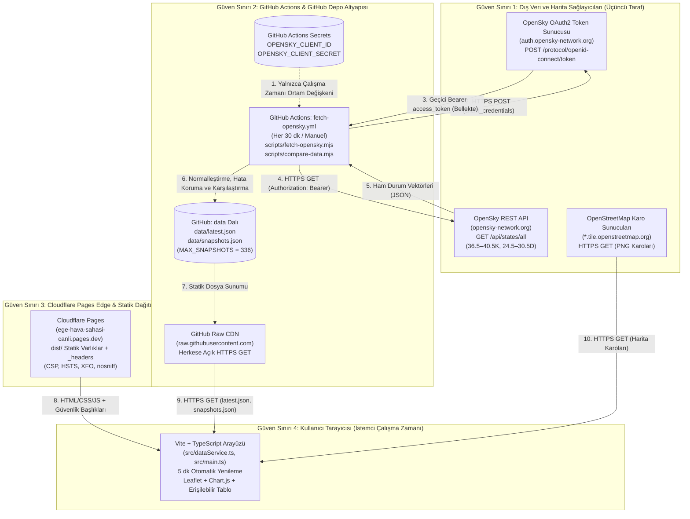

# Veri Akış Diyagramı (DFD) ve STRIDE Tehdit Modeli

**Proje:** Ege Hava Sahası Canlı (`ege-hava-sahasi-canli`)  
**Kapsam:** *BVA 2245 Kullanıcı Arayüzü Tasarımı* ve *Bulut Bilişim ve Siber Güvenlik* Ders Projesi Final Sürümü  
**Depo:** `https://github.com/Fylgja0/ege-hava-sahasi-canli`  
**Canlı Dağıtım:** `https://ege-hava-sahasi-canli.pages.dev/`

> **Not:** Bu belge, uygulamanın gerçek kaynak koduna (`scripts/fetch-opensky.mjs`, `scripts/compare-data.mjs`, `.github/workflows/fetch-opensky.yml`, `.github/workflows/ci.yml`, `src/dataService.ts`, `src/mapView.ts`, `src/main.ts`, `public/_headers`) dayanmaktadır. Kurgusal bileşen veya doğrulanmamış kontrol içermez.

---

## 1. Veri Akış Diyagramı (DFD) ve Güven Sınırları (Trust Boundaries)

Uygulama mimarisinde istemci (tarayıcı) ile dış veri sağlayıcısı (OpenSky Network API) birbirinden tamamen ayrılmıştır. Tarayıcı doğrudan OpenSky API'sine istek göndermez; yalnızca zamanlanmış arka plan iş akışının (`fetch-opensky.yml`) `data` dalına yayımladığı statik JSON dosyalarını okur.

### Mimari ve Kota İzolasyonu Özeti
1. **Tarayıcıda Sıfır Gizli Bilgi:** `OPENSKY_CLIENT_ID`, `OPENSKY_CLIENT_SECRET` ve `access_token` değerleri yalnızca GitHub Actions çalışma zamanında (`scripts/fetch-opensky.mjs`) bellekte tutulur; `latest.json`, `snapshots.json`, konsol günlükleri veya istemci paketine (`dist/`) asla yazılmaz.
2. **Sayfa Kazımasının (Scraping) OpenSky Kotasına Etkisi:** İstemci arayüzü (`https://ege-hava-sahasi-canli.pages.dev/`) veriyi doğrudan OpenSky API'sinden değil, `https://raw.githubusercontent.com/Fylgja0/ege-hava-sahasi-canli/data/data` adresindeki herkese açık statik JSON dosyalarından okur. Bu nedenle **canlı web sayfasının sık yenilenmesi veya kazınması (scraping) OpenSky API kredisini/kotasını doğrudan tüketmez**. OpenSky API çağrıları yalnızca GitHub Actions üzerindeki zamanlanmış iş akışı (`cron: '*/30 * * * *'`) tarafından gerçekleştirilir.

---

## 2. Varlıklar ve Güven Sınırları

| Kod | Varlık / Bileşen | Açıklama ve Güven Seviyesi |
| :--- | :--- | :--- |
| **A1** | OpenSky OAuth2 İstemci Kimlik Bilgileri | `OPENSKY_CLIENT_ID` ve `OPENSKY_CLIENT_SECRET` (GitHub Actions Secrets içinde saklanır, yüksek gizlilik). |
| **A2** | Veri Toplama ve Karşılaştırma Betikleri | `scripts/fetch-opensky.mjs` ve `scripts/compare-data.mjs` (Node.js 24, güvenilir CI ortamında çalışır). |
| **A3** | Zaman Serisi ve Anlık Uçuş Verisi | `data/latest.json` ve `data/snapshots.json` (`data` dalında yayımlanan, herkese açık okunabilir veri). |
| **A4** | Statik Web Uygulaması ve Başlıklar | Cloudflare Pages üzerinden sunulan `dist/` çıktısı, `public/_headers` ve `public/.well-known/security.txt`. |
| **A5** | İstemci DOM ve Görselleştirme Katmanı | Kullanıcının tarayıcısında çalışan Leaflet haritası, Chart.js grafiği ve erişilebilir uçak tablosu. |

---

## 3. STRIDE Tehdit Analizi ve Uygulanan Kontroller

| STRIDE Kategorisi | Tehdit Senaryosu | Etkilenen Bileşen | Depoda Uygulanan Somut Kontrol (Kod / Yapılandırma) | Kalan Risk / Dış Panel Gereksinimi |
| :--- | :--- | :--- | :--- | :--- |
| **S — Spoofing (Kimlik Sahtekarlığı)** | Sahte veya süresi dolmuş kimlik bilgileriyle OpenSky API erişimi; üçüncü taraf GitHub Action bileşenlerinin taklit edilmesi. | `fetch-opensky.yml`, `ci.yml`, `scripts/fetch-opensky.mjs` | • OAuth2 `client_credentials` akışı resmi OpenID Connect uç noktası üzerinden HTTPS ile yapılır. • Tüm GitHub Actions adımları (`actions/checkout`, `actions/setup-node`, `gitleaks/gitleaks-action`) tam 40 karakterlik commit SHA ile sabitlenmiştir. | OpenSky istemci sırlarının süresi dolduğunda veya iptal edildiğinde GitHub Secrets üzerinden manuel döndürülmesi (rotation) gerekir. |
| **T — Tampering (Veri veya Kod Bütünlüğünün Bozulması)** | Dış API'den gelen `callsign` veya `originCountry` alanlarına zararlı HTML/JS enjekte edilmesi (DOM XSS); CI üzerinden `main` dalına yetkisiz veri yazılması. | `src/mapView.ts`, `src/main.ts`, `fetch-opensky.yml`, `public/_headers` | • `src/mapView.ts` içinde `escapeHtml()` ve `src/main.ts` içinde güvenli DOM düğümleri (`textContent`) kullanılarak dış metinler temizlenir. • `public/_headers` içinde `script-src 'self'` (inline script yasaklı) uygulanır. • Veri yazımı `main` dalına değil, yalnızca izole `data` dalına yapılır. | `main` dalı için GitHub Branch Protection kurallarının depo sahibi tarafından GitHub Settings panelinden aktif tutulması gerekir. |
| **R — Repudiation (İnkâr Edilebilirlik)** | Veri güncellemesinin ne zaman ve hangi hata/başarı durumuyla yapıldığının izlenememesi. | `scripts/fetch-opensky.mjs`, `fetch-opensky.yml` | • Her çekim denemesi `latest.json` içindeki `lastAttempt` (`timestamp`, `status`, `httpStatus`, `errorType`) alanına kaydedilir. • `data` dalı commit geçmişi zaman damgalıdır; `compare-data.mjs` yalnızca gerçek veri veya hata türü değiştiğinde commit üretir. | GitHub Actions çalışma günlükleri (run logs) GitHub'ın saklama süresi (retention) politikasına tabidir. |
| **I — Information Disclosure (Bilgi İfşası)** | OAuth2 `client_secret` veya `access_token` değerinin JSON dosyalarına, loglara veya istemci paketine (`dist/`) sızması; HTTP üzerinden dinleme. | `scripts/fetch-opensky.mjs`, `ci.yml`, `public/_headers` | • `tests/fetch-opensky.test.mjs` gizli bilgilerin JSON ve `stdout`/`stderr` çıktılarında yer almadığını otomatik doğrular. • `.github/workflows/ci.yml` içinde `gitleaks/gitleaks-action` (`v3.0.0`) tüm git geçmişini tarar. • `public/_headers` içinde `Strict-Transport-Security: max-age=31536000` tanımlıdır. | `data` dalındaki uçuş verileri (`latest.json`, `snapshots.json`) tasarım gereği herkese açıktır; içinde kişisel veri veya gizli anahtar bulunmaz. |
| **D — Denial of Service (Hizmet Engelleme)** | OpenSky API kesintisi veya `HTTP 429` durumunda son başarılı verinin silinmesi; yoğun istemci trafiğinin OpenSky kotasını tüketmesi; sekme açıkken aşırı istek atılması. | `scripts/fetch-opensky.mjs`, `src/main.ts`, `src/dataService.ts` | • Hata anında son başarılı `latest.json` ve `snapshots.json` korunur, sahte canlı ölçüm eklenmez. • İstemci `raw.githubusercontent.com` üzerinden okuma yaptığı için sayfa kazıması OpenSky kotasını tüketmez. • `src/main.ts` arka plan sekmelerinde (`hidden`) yenilemeyi durdurur ve `isRefreshing` kilidi uygular. | `*.pages.dev` alt alan adında özel Cloudflare Zone WAF / Rate Limiting kuralı tanımlanamayabilir; özel alan adı (custom domain) ve Cloudflare Zone gerekir. |
| **E — Elevation of Privilege (Yetki Yükseltme)** | CI veya veri toplama iş akışındaki `GITHUB_TOKEN` yetkilerinin kötüye kullanılması; bağımlılık zafiyetleri üzerinden kod çalıştırma. | `ci.yml`, `fetch-opensky.yml`, `dependabot.yml` | • `ci.yml` yalnızca `permissions: contents: read` ve `persist-credentials: false` kullanır. • `npm audit --audit-level=high` her CI çalışmasında zorunludur. • `.github/dependabot.yml` haftalık `npm` ve `github-actions` güncellemelerini denetler. | Üretim dağıtımı Cloudflare Pages hesabı üzerinden yönetildiğinden Cloudflare hesap erişiminde MFA (2FA) kullanıcı sorumluluğundadır. |

---

## 4. Bilinen Mimari Ödünleşimler (Trade-offs) ve Açık Noktalar

1. **CSP `style-src 'unsafe-inline'` İstisnası:**
   - **Gerekçe:** Leaflet harita kütüphanesi, harita karolarının konumlandırılması (`transform: translate3d(...)`) ve uçak işaretçilerinin yön açısına (`transform: rotate(...)`) göre döndürülmesi için DOM öğelerine çalışma zamanında satır içi CSS uygular.
   - **Azaltıcı Kontrol:** `script-src 'self'` ve `object-src 'none'` katı biçimde korunarak satır içi JavaScript çalıştırılması tamamen engellenmiştir.
2. **Cloudflare WAF / Rate-Limiting Durumu (`*.pages.dev` Kısıtı):**
   - Canlı uygulama şu anda `https://ege-hava-sahasi-canli.pages.dev/` adresinde barındırılmaktadır. Cloudflare üzerinde özelleştirilmiş Zone WAF / Rate Limiting kuralları tipik olarak bir Cloudflare Zone'a bağlı özel alan adı (custom domain) gerektirir. Kaynak kod içinde WAF kuralı "doğrulandı" olarak kabul edilmemelidir.
3. **`security.txt` İletişim Kanalı Doğrulaması:**
   - `public/.well-known/security.txt` içinde uydurma e-posta kullanılmamıştır. GitHub Security Advisories özel bildirim bağlantısının (`/security/advisories/new`) dış araştırmacılara açık olması için depo sahibi tarafından GitHub ayarlarından **Private vulnerability reporting** özelliğinin açılması gerekir.
